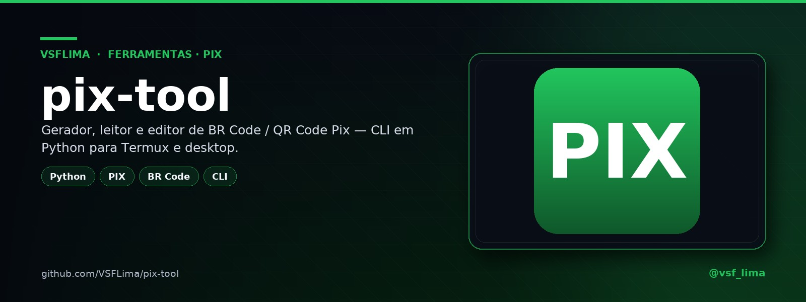

<div align="center">



# 💚 pix-tool

**BR Code e QR Code Pix na linha de comando — gerar, ler, editar e diagnosticar.**

CLI em Python + biblioteca para montar o copia-e-cola, decodificar, trocar chave/valor/nome/txid, converter base64 e normalizar no Anexo Q.


[](https://t.me/vsf_lima)

</div>

---

## 📖 Sobre

O **pix-tool** é uma CLI Python para **BR Code Pix** (o “copia-e-cola”). Ele monta o código a partir de uma chave, lê e decodifica um código existente, edita campos (chave, valor, nome/cidade e `txid`), converte entre BR Code e base64, normaliza no formato estrito do **Anexo Q** e diagnostica se o valor pode ser fixado dentro do código.

A biblioteca `pix_core.py` implementa TLV, CRC16, validação de chave (CPF, CNPJ, telefone, e-mail e aleatória), parsing e edição. O `pix_cli.py` é a interface de terminal; o script `pix` é o atalho executável.

> A ferramenta entrega o **payload** do QR Code (`pix-qrcode-...`); a imagem pode ser gerada em qualquer biblioteca de QR Code. Ela **não processa pagamentos**.

## ✨ Recursos

| Comando | O que faz |
|---|---|
| `gerar` | Cria o BR Code + payload do QR Code a partir da chave, valor, nome, cidade, `txid` e URL. |
| `ler` | Decodifica BR Code, base64, `pix-qrcode-...`, `@arquivo` ou stdin. |
| `qrcode` | Converte BR Code ↔ base64 (com prefixo opcional). |
| `chave` | Troca a chave Pix de um código existente. |
| `valor` | Define ou remove o valor (use `0` para deixar livre). |
| `nome` | Define nome e cidade do recebedor. |
| `txid` | Define o identificador da transação. |
| `normalizar` | Reescreve na forma estrita do Anexo Q para apps rigorosos. |
| `diagnostico` | Diz se o valor pode ser fixado dentro do código. |

## 🖼️ Prévia

<p align="center">
  
</p>
<p align="center"><em>Gerar, ler, editar, normalizar e diagnosticar BR Code.</em></p>

## 🛠️ Stack

- **Linguagem:** Python 3
- **CLI:** `argparse`
- **Formato:** EMV® QRCPS-MPM / BR Code (TLV + CRC16)
- **Dependências:** biblioteca padrão (sem pacotes externos)
- **Testes:** `unittest` (`test_pix.py` + `test_cli.py`)

## 📁 Estrutura

```text
.
├── pix            # atalho executável (shebang Termux)
├── pix_cli.py     # interface de linha de comando
├── pix_core.py    # TLV, CRC16, parsing, edição e QR payload
├── test_pix.py    # testes da biblioteca
└── test_cli.py    # testes ponta a ponta da CLI
```

## 🚀 Instalação

Não há dependências externas:

```bash
git clone https://github.com/VSFLima/pix-tool.git
cd pix-tool
chmod +x pix
./pix --help
# ou: python3 pix_cli.py --help
```

## ⚙️ Uso

### Gerar

```bash
./pix gerar "email@exemplo.com" -v 80,00 -n "Loja" -c "Sao Paulo" -t "pedido123"
./pix --json gerar "email@exemplo.com" -v 80,00 -n "Loja" -c "Sao Paulo"
```

A saída traz o **BR Code** (copia-e-cola) e o **payload** `pix-qrcode-...`.

### Ler

```bash
./pix ler "000201..."
./pix ler @codigo.txt
echo "000201..." | ./pix ler -
./pix --json ler "000201..."
```

### Editar

```bash
./pix chave "000201..." "nova-chave@exemplo.com"
./pix valor "000201..." 0
./pix nome "000201..." "Loja" "Sao Paulo"
./pix txid "000201..." "pedido123"
```

### Converter e normalizar

```bash
./pix qrcode qr "000201..."
./pix qrcode brcode "pix-qrcode-..."
./pix normalizar "000201..." -v 0,01
./pix diagnostico "000201..."
```

## 🧪 Testes

```bash
python3 -m unittest discover -v
```

A suíte cobre TLV, CRC16, montagem/parsing do BR Code, edição, conversão e o fluxo da CLI.

## ⚠️ Uso responsável

- Confira **chave, valor, nome e cidade** antes de pagar ou compartilhar um código.
- A ferramenta **não move dinheiro** e não substitui a conferência no app do banco.
- Use para automação, testes e integração; não use para fraude, cobrança enganosa ou ocultação de recebedor.

## 📌 Status

CLI + biblioteca estáveis no escopo atual, com testes de unidade e de integração. Repositório privado.

## 🙏 Créditos

- **Projeto e código:** VSFLima
- **Distribuição:** [@vsf_lima](https://t.me/vsf_lima)
- **Formato:** BR Code / EMV® QRCPS-MPM

---

<p align="center">Feito por <a href="https://t.me/vsf_lima">@vsf_lima</a> — VSFLima</p>
